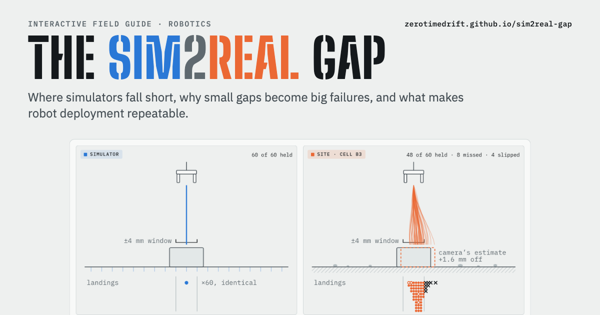

# The Sim2Real Gap

An interactive field guide to the sim-to-real gap in robotics: where simulators fall short, why small gaps become big failures, how teams close them, and what makes deployment repeatable.

**Live page: https://zerotimedrift.github.io/sim2real-gap/**

## What's inside

Twelve figures, most of them live models you can drag:

1. **One world in training, another on site.** The same pick run 60 times in simulation and on site, and how training ranges trade coverage against sharpness.
2. **Where simulators fall short.** The robot control loop with twelve gaps (contact, soil and rubble, calibration, actuators, delay, wear and more). Each one shows what the simulator assumes, what reality does, how it shows up on site and what teams do about it.
3. **Why small gaps become big failures.** An error budget for a pick, a controller that goes unstable under delay, and how per-step failures compound over long tasks.
4. **Closing the gap.** Which technique addresses which gap, with published sim-versus-real results (Peng et al., ICRA 2018).
5. **Working once versus working every time.** Accuracy versus repeatability (ISO 9283), a simulated fleet over 30 days, how many trials a success rate needs, and a deployment loop that feeds real failures back into simulation.

Figures 1, 2, 4, 5, 6 and 10 are illustrative models whose parameters are stated on the page. Figure 8 and the field notes cite published work, and the full source list is at the bottom of the page.

## Running it

The whole guide is one static file, `index.html`, with no build step. Open it in a browser, or serve the folder with any static file server.
